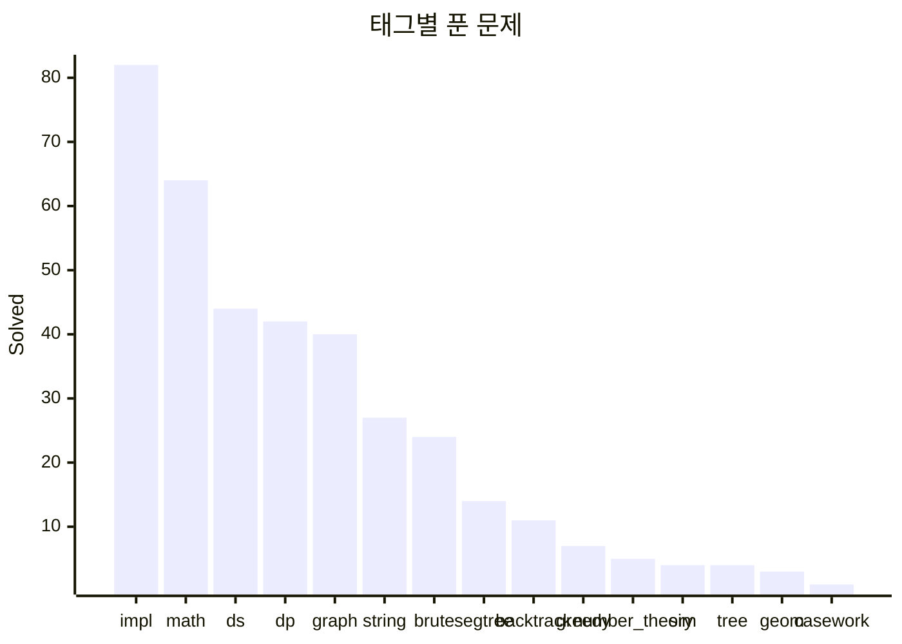
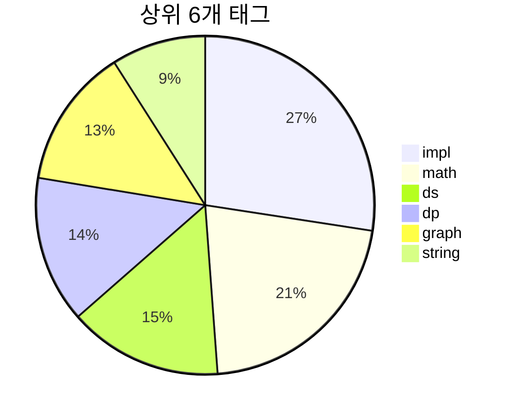

<!-- START AUTO-UPDATE -->

$\huge{\rm{\color{#27e2a4}Platinum V}}$까지 **+90** 남음

## 레이팅 종합

| Gold I | +1,510
| --- | --: |
| 상위 100문제의 난이도 합 | **+1,239** |
| CLASS 4 | **+150** |
| 문제수에 따른 보너스 점수 _(다음 점수까지 **3**문제[^1])_ | **+121** |

## 난이도 별 얻게 될 점수

| Level | Earning Points |
| :---: | -------------: |
| Platinum I | +10 |
| Platinum II | +9 |
| Platinum III | +8 |
| Platinum IV | +7 |
| Platinum V | +6 |
| **Gold I** | **+5** |
| Gold II | +4 |
| Gold III | +3 |
| Gold IV | +2 |
| Gold V | +1 |

[^1]: `122 = round(200 * (1 - 0.997 ** 268))`

## 태그별 통계

| Tag | Solved | Rating |
| --- | -----: | -----: |
| [impl](https://solved.ac/problems/tags/impl) | 82 | Silver I (762) |
| [math](https://solved.ac/problems/tags/math) | 64 | Silver I (701) |
| [ds](https://solved.ac/problems/tags/ds) | 44 | Gold IV (1,035) |
| [dp](https://solved.ac/problems/tags/dp) | 42 | Gold V (887) |
| [graph](https://solved.ac/problems/tags/graph) | 40 | Gold V (938) |
| [string](https://solved.ac/problems/tags/string) | 27 | Silver IV (364) |
| [brute](https://solved.ac/problems/tags/brute) | 24 | Silver III (467) |
| [segtree](https://solved.ac/problems/tags/segtree) | 14 | Silver III (460) |
| [backtrack](https://solved.ac/problems/tags/backtrack) | 11 | Silver V (223) |
| [greedy](https://solved.ac/problems/tags/greedy) | 7 | Bronze II (128) |
| [number_theory](https://solved.ac/problems/tags/number_theory) | 5 | Bronze III (94) |
| [sim](https://solved.ac/problems/tags/sim) | 4 | Bronze III (104) |
| [tree](https://solved.ac/problems/tags/tree) | 4 | Bronze III (98) |
| [geom](https://solved.ac/problems/tags/geom) | 3 | Bronze V (40) |
| [casework](https://solved.ac/problems/tags/casework) | 1 | Unrated (28) |
<!-- END AUTO-UPDATE -->
